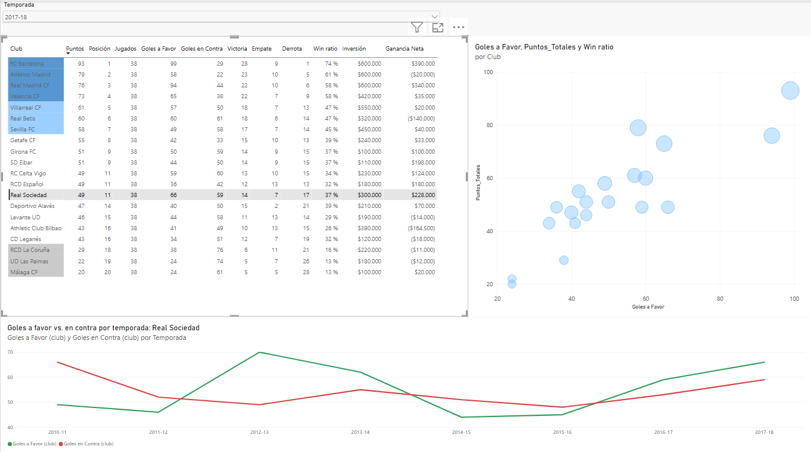
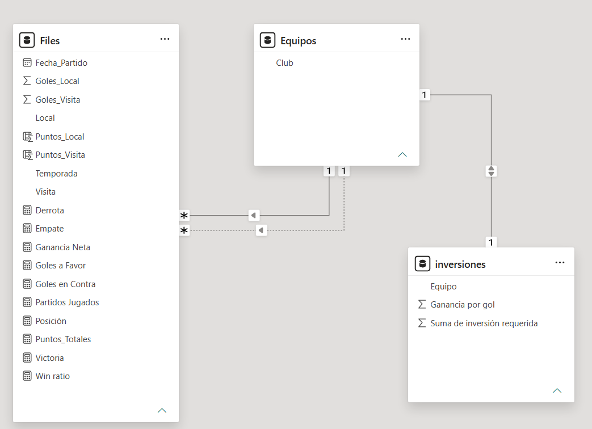
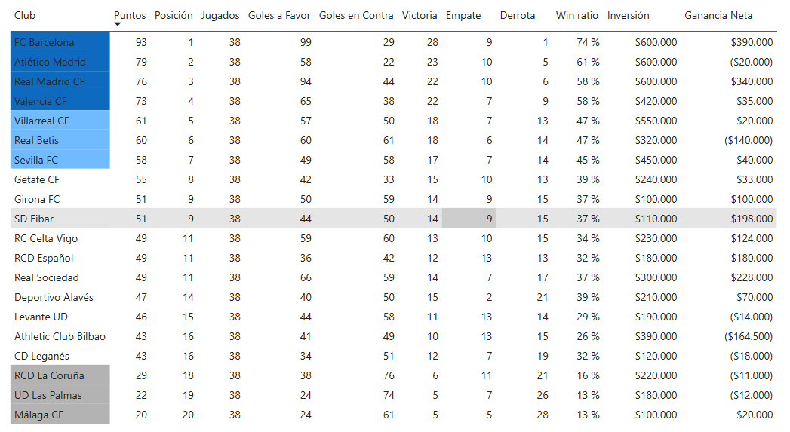
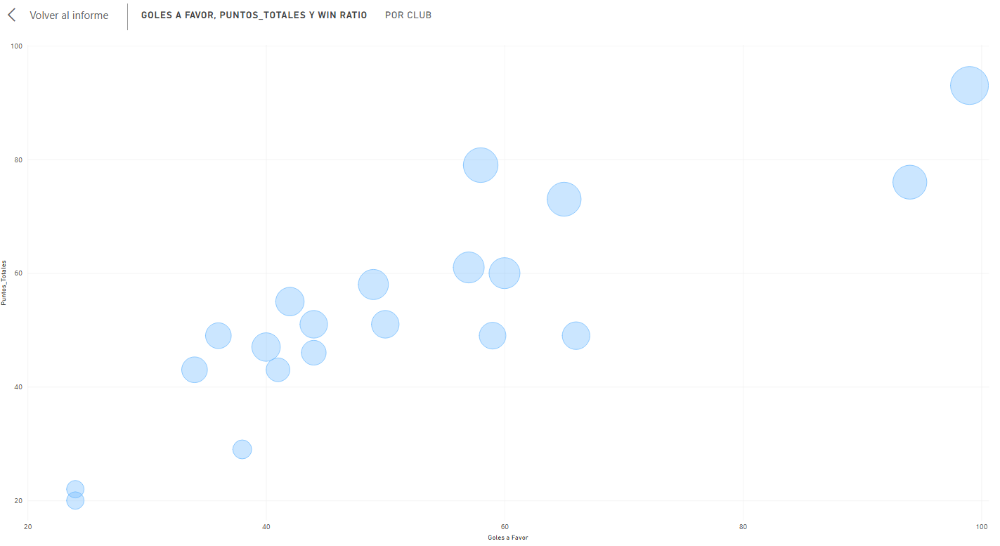
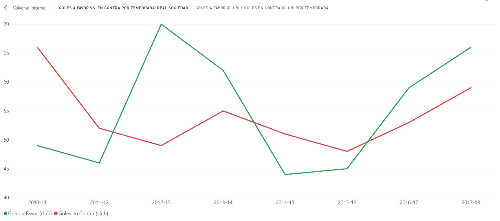

# ⚽ La Liga Sponsorship Analysis — Power BI

Tablero en **Power BI** para decidir en qué equipo de La Liga invertir un patrocinio, combinando **10 temporadas de resultados (2008-09 a 2017-18)** con los **costos de patrocinio y el retorno por gol** de cada club.

> Prueba técnica realizada para un proceso de selección como desarrollador de tableros Power BI.



---

## 📌 El problema

Una marca de bebidas energéticas (*Energetic Soda*) quiere patrocinar a un equipo de La Liga con un **presupuesto de $400.000**. El CEO pide:

1. **Replicar la tabla general** de la temporada 2017-18.
2. **Recomendar un equipo** que:
   - entre en el presupuesto,
   - maximice el retorno (la marca gana un monto fijo por cada gol del equipo),
   - sea **consistente**: que no tenga riesgo de perder la categoría,
   - y, si es posible, que juegue competencias europeas.

Detalle completo en [`docs/enunciado.md`](docs/enunciado.md).

## 🛠️ Cómo lo resolví

| Etapa | Herramienta | Qué hice |
|---|---|---|
| Ingesta y limpieza | **Power Query** | Unifiqué los 10 CSV en una sola tabla, extraje la temporada, separé el marcador (`2-1`) en goles local/visitante y limpié los nombres de equipos (quitando el número de jornada entre paréntesis). |
| Modelo de datos | **Power BI** | Tabla de partidos, dimensión de equipos y tabla de inversiones. Como cada equipo aparece como *Local* o como *Visita*, usé una relación activa y otra inactiva, activada con `USERELATIONSHIP`, para sumar las dos caras de cada partido. |
| Métricas | **DAX** | Puntos, partidos ganados/empatados/perdidos, goles a favor/en contra, win ratio, posición dinámica con `RANKX` y ganancia neta del patrocinio. Ver [`docs/medidas_dax.md`](docs/medidas_dax.md). |
| Visualización | **Power BI** | Tabla general filtrable por temporada, con color según la zona de clasificación (Champions, Europa League, descenso), dispersión goles vs. puntos y evolución histórica del club seleccionado, con título dinámico. Diseño limpio orientado a gerencia. |



## 📊 El tablero

**Tabla general 2017-18** (réplica pedida por el CEO, con inversión y ganancia neta por equipo):



**Goles a favor vs. puntos totales** — qué equipos convierten goles en resultados:



**Evolución del equipo seleccionado**: al hacer clic en un club de la tabla, el gráfico muestra sus goles a favor y en contra en las 10 temporadas (en la imagen, Real Sociedad):



## ✅ Conclusión

**Recomiendo invertir en la Real Sociedad.**

| Criterio | Real Sociedad |
|---|---|
| Inversión requerida | **$300.000** (dentro del presupuesto de $400.000) |
| Goles a favor 2017-18 | 66 |
| Ganancia por gol | $8.000 |
| **Ganancia neta 2017-18** | **$228.000** — la más alta entre los equipos que entran en el presupuesto |
| Posición 2017-18 | 11° (49 pts, empatado con Celta y Espanyol; 20 puntos por encima del descenso) |
| Descensos en las últimas 10 temporadas | **0** |
| Clasificaciones a Europa (top 7) | 3 veces |

**Por qué:**
- **Retorno:** es la opción con mejor ganancia neta de todas las que entran en el presupuesto. La segunda (SD Eibar) deja $198.000.
- **Estabilidad:** desde su regreso a Primera en 2010-11 nunca terminó en zona de descenso, con una posición promedio de 9,4.
- **Potencial europeo:** en tres temporadas del período terminó entre los 7 primeros, lo que le da a la marca exposición internacional.
- **Tendencia goleadora en alza:** sus goles a favor crecieron en las últimas temporadas (45 → 59 → 66 entre 2015-16 y 2017-18), y el retorno del patrocinio depende directamente de esa variable.

**Alternativa (plan B):** *RCD Espanyol* — $180.000 de inversión y $180.000 de ganancia neta en 2017-18, con las 10 temporadas en Primera sin descender. Menor retorno, pero deja más margen del presupuesto.

> Los equipos con mejor retorno absoluto (FC Barcelona, Real Madrid) requieren $600.000 y quedan fuera del presupuesto.

## 📁 Estructura del repositorio

```
├── dashboard/
│   └── LaLiga_Sponsorship.pbix   # Tablero Power BI
├── data/
│   ├── 1-liga_2008_09.csv … 1-liga_2017_18.csv   # Resultados por temporada
│   └── investments.csv           # Costo de patrocinio y ganancia por gol
├── docs/
│   ├── enunciado.md              # Consigna del ejercicio
│   └── medidas_dax.md            # Medidas DAX y transformaciones
└── images/                       # Capturas del tablero
```

## ▶️ Cómo abrirlo

1. Descargar o clonar el repositorio.
2. Abrir `dashboard/LaLiga_Sponsorship.pbix` con [Power BI Desktop](https://powerbi.microsoft.com/desktop/) (gratuito).
3. Si pide actualizar datos, apuntar el origen a la carpeta `data/` (*Inicio → Transformar datos → Configuración de origen de datos*).
