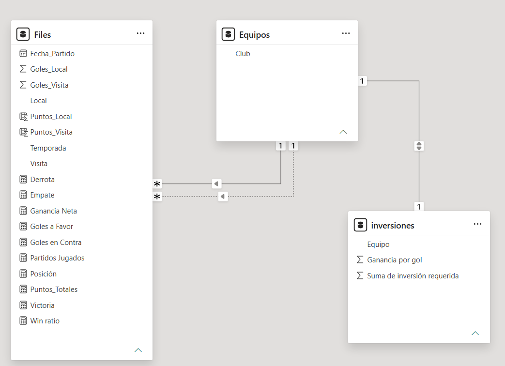

# Modelo, medidas DAX y transformaciones

## Modelo de datos



| Tabla | Contenido | Origen |
|---|---|---|
| `Files` | Un registro por partido (10 temporadas, 3.800 partidos): fecha, local, visita, goles y puntos de cada lado | 10 CSV combinados en Power Query |
| `Equipos` | Dimensión con un registro por club | Tabla calculada en DAX |
| `inversiones` | Costo de patrocinio y ganancia por gol por club | `investments.csv` |

### El desafío: un equipo aparece en dos columnas

Cada partido tiene a un club como **Local** y a otro como **Visita**, así que para calcular cualquier métrica de un equipo hay que sumar las dos "caras" de sus partidos. Lo resolví con **dos relaciones** entre `Equipos` y `Files`:

- `Equipos[Club]` → `Files[Local]` — **activa** (línea continua).
- `Equipos[Club]` → `Files[Visita]` — **inactiva** (línea punteada), que se activa solo dentro de cada medida con `USERELATIONSHIP`.

Así, cada medida tiene la forma *(lo que hizo como local) + CALCULATE(lo que hizo como visitante, USERELATIONSHIP(...))*, y la tabla, los filtros y los gráficos trabajan sobre una única dimensión de equipos.

## Columnas calculadas

Puntos que obtiene cada lado en el partido (victoria = 3, empate = 1, derrota = 0):

```dax
Puntos_Local =
    IF ( Files[Goles_Local] > Files[Goles_Visita], 3,
        IF ( Files[Goles_Local] = Files[Goles_Visita], 1, 0 ) )

Puntos_Visita =
    IF ( Files[Goles_Visita] > Files[Goles_Local], 3,
        IF ( Files[Goles_Visita] = Files[Goles_Local], 1, 0 ) )
```

## Medidas

```dax
Puntos_Totales =
    SUM ( Files[Puntos_Local] )
        + CALCULATE ( SUM ( Files[Puntos_Visita] ), USERELATIONSHIP ( Equipos[Club], Files[Visita] ) )

Partidos Jugados =
    CALCULATE ( COUNTROWS ( Files ) )
        + CALCULATE ( COUNTROWS ( Files ), USERELATIONSHIP ( Equipos[Club], Files[Visita] ) )

Goles a Favor =
    SUM ( Files[Goles_Local] )
        + CALCULATE ( SUM ( Files[Goles_Visita] ), USERELATIONSHIP ( Equipos[Club], Files[Visita] ) )

Goles en Contra =
    SUM ( Files[Goles_Visita] )
        + CALCULATE ( SUM ( Files[Goles_Local] ), USERELATIONSHIP ( Equipos[Club], Files[Visita] ) )

Victoria =
    CALCULATE ( COUNTROWS ( Files ), Files[Puntos_Local] = 3 )
        + CALCULATE ( COUNTROWS ( Files ), Files[Puntos_Visita] = 3, USERELATIONSHIP ( Equipos[Club], Files[Visita] ) )

Empate =
    CALCULATE ( COUNTROWS ( Files ), Files[Puntos_Local] = 1 )
        + CALCULATE ( COUNTROWS ( Files ), Files[Puntos_Visita] = 1, USERELATIONSHIP ( Equipos[Club], Files[Visita] ) )

Derrota =
    CALCULATE ( COUNTROWS ( Files ), Files[Puntos_Local] = 0 )
        + CALCULATE ( COUNTROWS ( Files ), Files[Puntos_Visita] = 0, USERELATIONSHIP ( Equipos[Club], Files[Visita] ) )

Win ratio =
    DIVIDE ( [Victoria], [Partidos Jugados], 0 )

Posición =
    IF (
        HASONEVALUE ( Equipos[Club] ) && NOT ( ISBLANK ( [Puntos_Totales] ) ),
        RANKX ( ALLSELECTED ( Equipos[Club] ), [Puntos_Totales], , DESC, SKIP )
    )

Ganancia Neta =
    ( [Goles a Favor] * MAX ( inversiones[Ganancia por gol] ) )
        - MAX ( inversiones[Suma de inversión requerida] )
```

### Medidas del gráfico de evolución por equipo

A nivel liga, el total de goles a favor siempre es igual al de goles en contra (cada gol convertido es un gol recibido por otro equipo), así que el gráfico solo tiene sentido para **un club a la vez**. Estas medidas devuelven un valor solo cuando hay un único equipo seleccionado, y el título del gráfico se arma dinámicamente con su nombre.

```dax
Goles a Favor (club) =
    IF ( HASONEVALUE ( Equipos[Club] ), [Goles a Favor] )

Goles en Contra (club) =
    IF ( HASONEVALUE ( Equipos[Club] ), [Goles en Contra] )

Titulo Goles =
    IF (
        HASONEVALUE ( Equipos[Club] ),
        "Goles a favor vs. en contra por temporada: " & VALUES ( Equipos[Club] ),
        "Goles a favor vs. en contra por temporada (seleccioná un equipo en la tabla)"
    )
```

**Notas:**
- `Posición` usa `ALLSELECTED`, así que el ranking se recalcula según la temporada elegida en el filtro. Los equipos con los mismos puntos comparten posición (`SKIP` saltea los puestos siguientes: 9, 9, 11, 11, 11, 14…).
- `Ganancia Neta` usa `MAX` sobre `inversiones` porque, en el contexto de un club, hay un único valor de costo y de ganancia por gol.

## Transformaciones en Power Query

### `Files` — partidos de las 10 temporadas

Pasos principales:
1. Toma todos los CSV de la carpeta, excepto `investments.csv`, y los combina en una tabla.
2. Descarta las columnas `Round` y `HT` (resultado al entretiempo).
3. Separa el resultado final (`2-1`) en `Goles_Local` y `Goles_Visita`.
4. Limpia los nombres de equipos quitando la jornada entre paréntesis (`RCD La Coruña (1)` → `RCD La Coruña`).
5. Extrae la fecha del texto `(Fri) 19 Aug 2016 (33)` y la convierte a tipo fecha.
6. Obtiene la **temporada** a partir del nombre del archivo (`1-liga_2017_18.csv` → `2017-18`).

```powerquery
let
    Origen = Folder.Files("<ruta>\data"),
    #"Filas filtradas" = Table.SelectRows(Origen, each ([Name] <> "investments.csv")),
    #"Archivos ocultos filtrados1" = Table.SelectRows(#"Filas filtradas", each [Attributes]?[Hidden]? <> true),
    #"Invocar función personalizada1" = Table.AddColumn(#"Archivos ocultos filtrados1", "Transformar archivo", each #"Transformar archivo"([Content])),
    #"Columnas con nombre cambiado1" = Table.RenameColumns(#"Invocar función personalizada1", {"Name", "Source.Name"}),
    #"Otras columnas quitadas1" = Table.SelectColumns(#"Columnas con nombre cambiado1", {"Source.Name", "Transformar archivo"}),
    #"Columna de tabla expandida1" = Table.ExpandTableColumn(#"Otras columnas quitadas1", "Transformar archivo", Table.ColumnNames(#"Transformar archivo"(#"Archivo de ejemplo"))),
    #"Tipo cambiado" = Table.TransformColumnTypes(#"Columna de tabla expandida1",{{"Source.Name", type text}, {"Column1", type text}, {"Column2", type text}, {"Column3", type text}, {"Column4", type text}, {"Column5", type text}, {"Column6", type text}}),
    #"Columnas quitadas" = Table.RemoveColumns(#"Tipo cambiado",{"Column1", "Column5"}),
    #"Dividir columna por delimitador" = Table.SplitColumn(#"Columnas quitadas", "Column4", Splitter.SplitTextByDelimiter("-", QuoteStyle.Csv), {"Column4.1", "Column4.2"}),
    #"Tipo cambiado1" = Table.TransformColumnTypes(#"Dividir columna por delimitador",{{"Column4.1", type text}, {"Column4.2", Int64.Type}}),
    #"Texto extraído antes del delimitador" = Table.TransformColumns(#"Tipo cambiado1", {{"Column3", each Text.BeforeDelimiter(_, "("), type text}}),
    #"Texto extraído antes del delimitador1" = Table.TransformColumns(#"Texto extraído antes del delimitador", {{"Column6", each Text.BeforeDelimiter(_, "("), type text}}),
    #"Columnas con nombre cambiado" = Table.RenameColumns(#"Texto extraído antes del delimitador1",{{"Column3", "Local"}, {"Column6", "Visita"}}),
    #"Tipo cambiado2" = Table.TransformColumnTypes(#"Columnas con nombre cambiado",{{"Column4.1", Int64.Type}}),
    #"Filas filtradas1" = Table.SelectRows(#"Tipo cambiado2", each ([Local] <> "Team 1")),
    #"Columnas con nombre cambiado2" = Table.RenameColumns(#"Filas filtradas1",{{"Column4.1", "Goles_Local"}, {"Column4.2", "Goles_Visita"}, {"Column2", "Fecha_Partido"}}),
    #"Texto extraído entre delimitadores" = Table.TransformColumns(#"Columnas con nombre cambiado2", {{"Fecha_Partido", each Text.BetweenDelimiters(_, ")", "("), type text}}),
    #"Valor reemplazado" = Table.ReplaceValue(#"Texto extraído entre delimitadores","1-liga_","",Replacer.ReplaceText,{"Source.Name"}),
    #"Valor reemplazado1" = Table.ReplaceValue(#"Valor reemplazado","_","-",Replacer.ReplaceText,{"Source.Name"}),
    #"Valor reemplazado2" = Table.ReplaceValue(#"Valor reemplazado1",".csv","",Replacer.ReplaceText,{"Source.Name"}),
    #"Tipo cambiado3" = Table.TransformColumnTypes(#"Valor reemplazado2",{{"Fecha_Partido", type date}}),
    #"Columnas con nombre cambiado3" = Table.RenameColumns(#"Tipo cambiado3",{{"Source.Name", "Temporada"}})
in
    #"Columnas con nombre cambiado3"
```

### `inversiones` — costos de patrocinio

Pasos principales: promueve encabezados, traduce los nombres de columnas, quita los símbolos `$` y los separadores de miles, y convierte los montos a moneda usando la configuración regional `en-US`, porque el archivo usa punto como separador decimal.

```powerquery
let
    Origen = Csv.Document(File.Contents("<ruta>\data\investments.csv"),[Delimiter=",", Columns=4, Encoding=1252, QuoteStyle=QuoteStyle.None]),
    #"Tipo cambiado" = Table.TransformColumnTypes(Origen,{{"Column1", type text}, {"Column2", type text}, {"Column3", type text}, {"Column4", type text}}),
    #"Encabezados promovidos" = Table.PromoteHeaders(#"Tipo cambiado", [PromoteAllScalars=true]),
    #"Columnas con nombre cambiado" = Table.RenameColumns(#"Encabezados promovidos",{{"Team", "Club"}, {"Investment required", "Inversion requerida"}, {"Profit per goal", "Ganancia por gol"}}),
    #"Columnas quitadas" = Table.RemoveColumns(#"Columnas con nombre cambiado",{""}),
    #"Valor reemplazado" = Table.ReplaceValue(#"Columnas quitadas","$","",Replacer.ReplaceText,{"Inversion requerida", "Ganancia por gol"}),
    #"Valor reemplazado1" = Table.ReplaceValue(#"Valor reemplazado",",","",Replacer.ReplaceText,{"Inversion requerida", "Ganancia por gol"}),
    #"Columnas con nombre cambiado1" = Table.RenameColumns(#"Valor reemplazado1",{{"Club", "Equipo"}}),
    #"Tipo cambiado con configuración regional" = Table.TransformColumnTypes(#"Columnas con nombre cambiado1", {{"Inversion requerida", Currency.Type}, {"Ganancia por gol", Currency.Type}}, "en-US"),
    #"Columnas con nombre cambiado2" = Table.RenameColumns(#"Tipo cambiado con configuración regional",{{"Inversion requerida", "Suma de inversión requerida"}})
in
    #"Columnas con nombre cambiado2"
```

### `Equipos` — dimensión de clubes

No se arma en Power Query: es una **tabla calculada en DAX**. Une los clubes que jugaron como local y como visitante y se queda con los valores únicos. Así incluye a todos los equipos que pasaron por Primera en las 10 temporadas, no solo a los 20 de 2017-18.

```dax
Equipos =
    DISTINCT ( UNION ( VALUES ( Files[Local] ), VALUES ( Files[Visita] ) ) )
```
